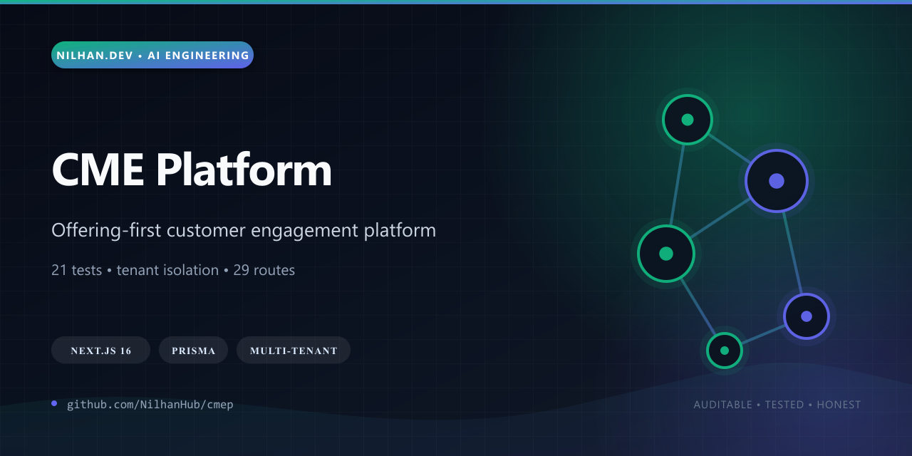
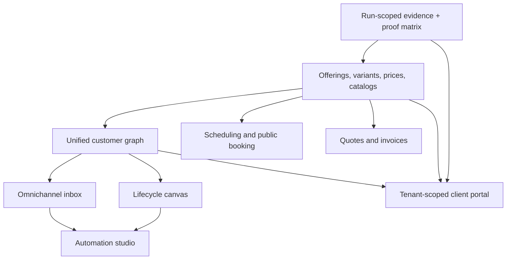

# CME Platform

[](https://github.com/NilhanHub/cmep/actions/workflows/ci.yml)
[](LICENSE)
[](package.json)



CMEP is a local-first, offering-first Customer Management & Engagement platform that connects the full commercial journey: catalog, customer graph, omnichannel inbox, lifecycle, automation, scheduling, quotes, invoices, public booking, and a tenant-scoped client portal.

The interesting part is the shared domain spine. Products, services, variants, recurring prices, bundles, catalogs, assignments, route bindings, and customer-offering links are first-class records consumed consistently across every surface rather than duplicated as UI prose.

## Why it stands out

- Multi-tenant access is enforced at query boundaries and exercised by negative-path isolation tests.
- One offering/catalog model drives sales, scheduling, automation, revenue, and portal visibility.
- Prisma and SQLite provide a deterministic local environment with typed persistence and repeatable demo reset.
- Run-scoped observability can emit logs, traces, metrics, state snapshots, HAR, DOM, screenshots, and Playwright traces.
- A proof matrix maps outward claims to concrete evidence instead of relying on screenshots alone.
- The release passes zero-advisory audits, lint, typecheck, a fresh DB seed, **21 tests**, and a **29-page/API-route** Next.js production build.



## Maturity boundary

CMEP is a working local reference implementation, not a hosted SaaS claim. Authentication is a deliberate local tenant/role simulation, the AI provider is deterministic by default with an adapter seam for real providers, and machine-local accountability archives are generated on demand rather than committed to this public source release.

## Stack

- Next.js App Router + TypeScript
- Tailwind CSS
- Prisma Client + SQLite
- deterministic local AI assistance
- seeded multi-tenant demo data
- local auth and client portal simulation

## Quick start

```bash
npm install
copy .env.example .env
npm run db:setup
npm run dev
```

Open `http://localhost:3000`.

## Local commands

```bash
npm run dev
npm run build
npm run lint
npm run typecheck
npm run test
npm run test:e2e
npm run db:setup
npm run db:migrate
npm run db:seed
npm run demo:reset
npm run san:preflight
npm run san:lock
npm run san:graph:validate
npm run evidence:smoke
npm run evidence:isolation
npm run evidence:catalog
npm run evidence:full
npm run verify:accountable
npm run oracle:bundle
```

## Accountable Local Verification

1. Install and seed:

   ```bash
   npm install
   copy .env.example .env
   npm run db:setup
   ```

2. Run the app locally:

   ```bash
   npm run dev
   ```

3. Run the catalog-specific proof:

   ```bash
   npm run evidence:catalog
   ```

4. Run the full accountable sweep:

   ```bash
   npm run verify:accountable
   ```

5. Inspect emitted evidence:

- latest accountable run pointer: `artifacts/runs/latest.json`
- run folders: `artifacts/runs/<timestamp>-<scenario>-<run-id>/`
- proof matrix: `san/state/proof-matrix.md`
- verification summary: `san/verification/latest.md`

6. Open the Playwright trace from the latest full run:

   ```bash
   npx playwright show-trace artifacts/runs/<latest-full-run>/playwright-trace.zip
   ```

7. Package the curated Oracle handoff:

   ```bash
   npm run oracle:bundle
   ```

   Bundle pointers are written to `artifacts/oracle/latest.json`, and a zip is copied to `~/Downloads`.

## Demo tenants and users

Tenant switcher in the top bar exposes these seeded personas:

- `Northstar Studio`
  - `Owner · Iris Navarro`
  - `Staff · Milo Grant`
  - `Client · Ava Hughes`
- `Signal Goods`
  - `Owner · Cora Sethi`
  - `Admin · Harper Lowe`
  - `Staff · Joel Hart`
  - `Client · Zoe Chang`

Portal access defaults to the first seeded client. Alternate client access is available from the portal switcher.

## Core surfaces

- `/app` mission control
- `/app/catalog` offering and catalog workbench
- `/app/customers` unified customer graph
- `/app/inbox` omnichannel conversation inbox
- `/app/lifecycle` lifecycle canvas
- `/app/automations` automation studio
- `/app/schedule` scheduling and intake
- `/app/revenue/quotes`
- `/app/revenue/invoices`
- `/client` client workspace
- `/book/[tenant]/[bookingType]` public booking pages

## Offering-first demo shape

Signal Goods now includes first-class products, services, bundles, recurring pricing, and catalog assignments:

- products: `Trail Pack`, `Hydrate Belt`, `Studio Bundle`
- services: `Demo Call`, `Onboarding Lab`, `Wholesale Rollout Strategy`, `Field Merchandising Support`, `Expedited Replacements`, `Ops Support Surcharge`
- bundles: `Spring Floor Set Bundle`

Northstar Studio remains service-led with offering-backed launch and production packages.

## Notes

- Local DB bootstrapping uses a deterministic SQL export plus seed path because Prisma migrate on this Windows environment was unreliable during bootstrap.
- Prisma remains the typed runtime client and adapter boundary for repositories.
- SAN doctrine, proof state, and durable verification truth live under `san/`.
